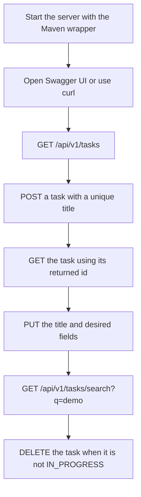
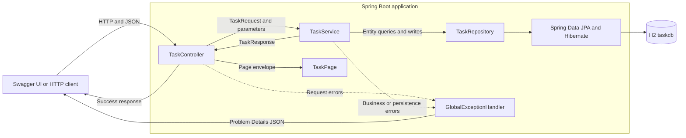
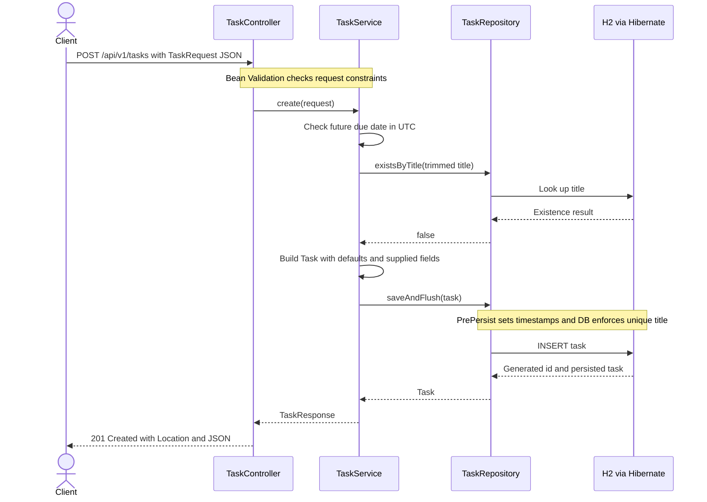
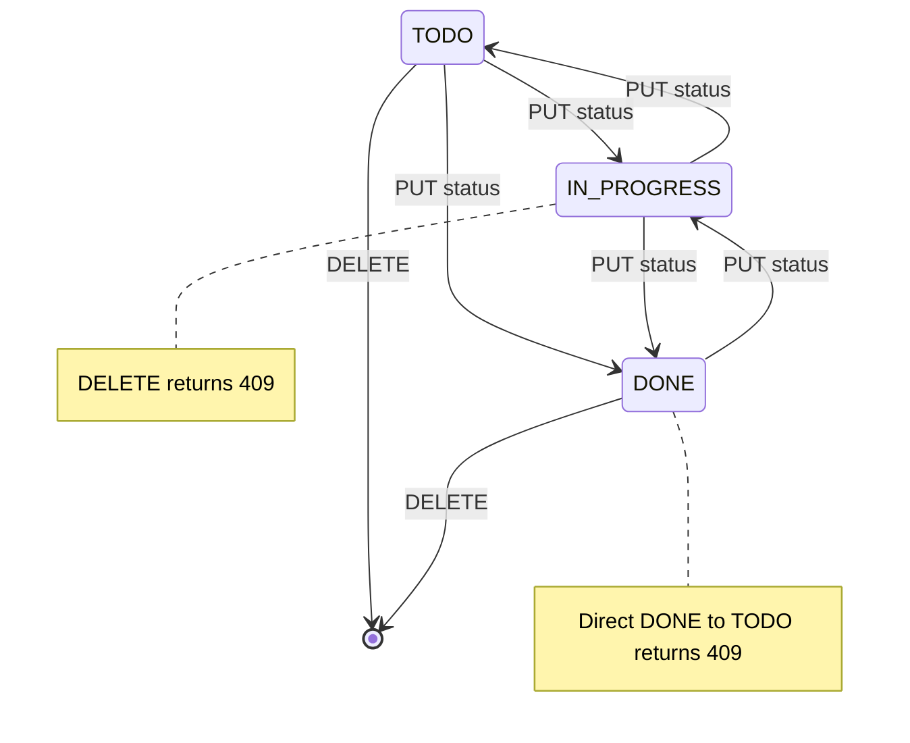

# Task API architecture and usage

This application is a single Java 17 / Spring Boot 3.2 REST service. Clients send
JSON over HTTP, the service applies task rules, and Spring Data JPA stores tasks
in an in-memory H2 database. Swagger UI provides an interactive API client.
There is no separate frontend or authentication layer.

## Run and explore

From `starter/`, with Java 17 selected:

```bash
./mvnw spring-boot:run
```

On Windows use `mvnw.cmd`. The wrapper downloads Maven on first use.
Open [Swagger UI](http://localhost:8080/swagger-ui.html), expand an operation,
select **Try it out**, enter its parameters or JSON body, and select **Execute**.
The machine-readable OpenAPI description is at `/api-docs`.



For example, create a task using the minimum request:

```bash
curl -i http://localhost:8080/api/v1/tasks \
  -H 'Content-Type: application/json' \
  -d '{"title":"Architecture demo"}'
```

A successful creation returns **201 Created**, a `Location` header such as
`/api/v1/tasks/4`, and a JSON task with its generated ID, default status `TODO`,
default priority `MEDIUM`, and timestamps. Use the actual returned ID below:

```bash
curl http://localhost:8080/api/v1/tasks/4
curl -X PUT http://localhost:8080/api/v1/tasks/4 \
  -H 'Content-Type: application/json' \
  -d '{"title":"Architecture demo","status":"DONE"}'
curl 'http://localhost:8080/api/v1/tasks/search?q=demo&page=0&size=20'
curl -i -X DELETE http://localhost:8080/api/v1/tasks/4
```

PUT always requires `title`. Omitted or null `status` and `priority` retain their
current values. Omitted or null `description` and `dueDate` clear those fields.

| Operation | Method and canonical path | Success |
|---|---|---|
| List | `GET /api/v1/tasks?page=0&size=20` | 200, `TaskPage` |
| Search | `GET /api/v1/tasks/search?q=demo` | 200, `TaskPage` |
| Read | `GET /api/v1/tasks/{id}` | 200, `TaskResponse` |
| Create | `POST /api/v1/tasks` | 201, `TaskResponse` and Location |
| Update | `PUT /api/v1/tasks/{id}` | 200, `TaskResponse` |
| Delete | `DELETE /api/v1/tasks/{id}` | 204, no body |

Creation returns the
`/api/v1/tasks/{id}` Location. Lists and searches are sorted by ID, use zero-based
pages, and accept page sizes 1–100 (default 20). A `TaskPage` contains `content`,
`page`, `size`, `totalElements`, and `totalPages`. Search trims `q` and matches a
case-insensitive literal substring in either title or description.

## Components and boundaries



| Source location under `src/main/` | Responsibility |
|---|---|
| `java/com/example/taskapi/TaskApiApplication.java` | Application entry point |
| `java/com/example/taskapi/controller/TaskController.java` | Routes, input validation, pagination, HTTP statuses and Location |
| `java/com/example/taskapi/dto/` | Request, response, and page records defining the API payloads |
| `java/com/example/taskapi/service/TaskService.java` | Business rules, transaction boundaries, entity-to-response mapping |
| `java/com/example/taskapi/repository/TaskRepository.java` | JPA CRUD, title uniqueness lookups, and paginated search |
| `java/com/example/taskapi/entity/` | Persisted task model and status/priority enums |
| `java/com/example/taskapi/exception/` | Business exceptions and centralized HTTP error translation |
| `resources/application.properties` | H2, schema generation, JSON, and OpenAPI configuration |
| `resources/data.sql` | Three example tasks inserted at startup |

Controllers return DTOs rather than JPA entities. The service is read-only
transactional by default, with writable transactions for create, update, and
delete. JPA sessions are not kept open while rendering HTTP responses
(`spring.jpa.open-in-view=false`).

## Creating a task



This diagram shows the successful path. Validation failures return **400**,
missing tasks return **404**, and business conflicts return **409**. The global
exception handler returns Problem Details JSON, adding an `errors` array for
request-body validation failures. Recognized database title-uniqueness failures
also become 409, covering duplicate inserts that race past the service check.
Unexpected errors are logged and return a generic **500** response.

## Task data and lifecycle

A `Task` has a generated `Long` ID, a required unique title (maximum 100
characters), optional description (maximum 500), status, priority, optional
`LocalDate` due date, and `Instant` creation/update timestamps. Titles are trimmed
before storage and uniqueness is case-sensitive. Priority is `LOW`, `MEDIUM`,
or `HIGH`. JPA callbacks set timestamps on insertion and update `updatedAt`
when persisted fields change.



The diagram shows status changes and deletion. Creation defaults to `TODO` but
also accepts an explicit valid status. Updates may retain the existing status.
The implementation blocks only the direct `DONE` to `TODO` transition, so a
`DONE` task can move through `IN_PROGRESS` to `TODO`.

On creation, a supplied due date must be after today in UTC. Updates can retain
or set past due dates. IDs must be positive. Search queries must be nonblank and
at most 500 characters.

## Storage and verification

H2 runs inside the application process at `jdbc:h2:mem:taskdb`. Hibernate uses
`create-drop`, and `data.sql` runs after schema creation. **Tasks are lost when
the process stops**, and the three sample tasks are restored on the next start.
The H2 console is at `/h2-console` (user `sa`, empty password), with remote console
access disabled. This configuration is for local training.

Run the checks without starting a standalone server:

```bash
./mvnw clean verify
```

Tests under `src/test/java/com/example/taskapi/` cover service rules with Mockito,
HTTP behavior with full-context MockMvc, JPA repository behavior, and exception
translation. JaCoCo enforces an 80% line coverage gate, excluding the application
launcher. Its report is at `target/site/jacoco/index.html`.
